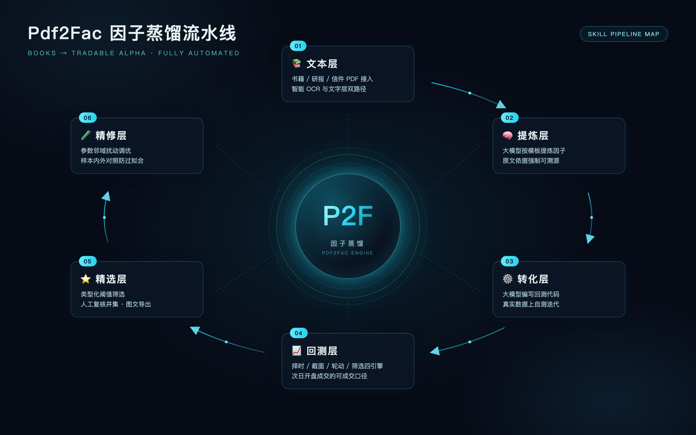

# Pdf2Fac：投资书籍 → 可检验 Alpha 因子的蒸馏 Skill



把沉淀在投资书籍/信件/研报 PDF 中的交易知识，系统化蒸馏为可回测、可筛选、可精修、
可组合的因子库。全流程自动化：PDF 文本化 → 大模型提炼因子卡 → 生成回测代码 →
可成交口径回测 → 精选导出 → 防过拟合精修 → 组合构建。

## 特性

- **文本层**：macOS Vision OCR（系统级中文模型、按页缓存断点续跑）与文字层直取双路径
- **提炼层**：每书一个大模型子代理，六字段硬格式因子卡，原文依据强制、推断需证据链
- **回测层**：择时/截面/轮动/筛选四类内核，统一可成交口径（T+1 开盘、剔一字涨停、
  ST 剔除、双边千 3 费用）
- **精选/精修**：类型化阈值 + 人工并集；OAT 参数扰动 + 训练/验证分样本 + 孤立峰检测
- **组合层**：多因子复合 + 回避增强、排名缓冲区、最短持有期、风险平价配置

## 快速开始

```bash
# 1. 实现数据接口 (scripts/data_source.py 里 7 个函数, 接你自己的数据源)
$EDITOR scripts/data_source.py

# 2. 初始化因子库 (SQLite, 免服务)
python3 scripts/init_db.py

# 3. 放一本书的 PDF 到 factor_gen/<书名>/pdf/<书名>.pdf, 然后文本化
python3 scripts/ocr_pdf.py factor_gen/<书名>/pdf/<书名>.pdf --out factor_gen/<书名>/ocr

# 4. 用大模型按 references/extraction-prompt.md 模板提炼因子卡
#    写到 factor_gen/<书名>/alpha/因子列表.md

# 5. 按 builders/example.py 模板实现 builder → scripts/builders/<书码>.py
#    并在 aggregate_factors.py 的 BOOK_CODES 登记书码

# 6. 入库 + 回测出图
python3 scripts/aggregate_factors.py
python3 scripts/factor_engine.py --only DEMO-F01 --save

# 7. 精选导出 / 精修
python3 scripts/filter_factors.py
python3 scripts/refine_factor.py --list
```

## 目录结构

```
scripts/            管线代码 (文本化/提炼入库/回测/精选/精修/组合)
scripts/builders/   因子 builder (每书一个文件, 模板见 example.py)
references/         提示词模板与各环节规范文档
data_cache/         数据缓存 (自动产生)
db/                 SQLite 因子库 (自动产生)
results/            回测绩效/图/精选报告 (自动产生)
```

## 依赖

- Python 3.8+，pandas / numpy / scipy / matplotlib
- OCR 功能需 macOS（Vision 框架，经 pyobjc 调用）；有文字层的 PDF 不需要
- 数据接口自备（接入你的 Wind/聚宽/米筐/本地库皆可，schema 见 data_source.py docstring）

## 许可与声明

仅供研究参考，不构成投资建议。回测绩效含口径假设，不代表未来收益。
